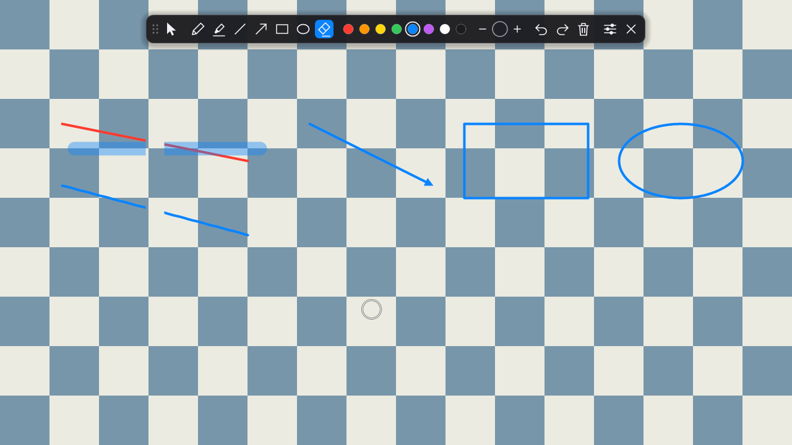
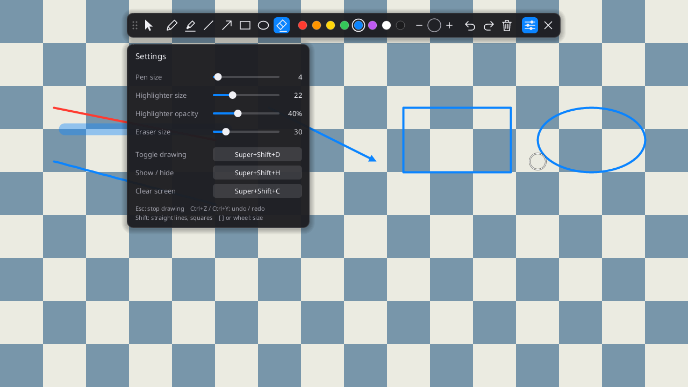

<div dir="rtl">

# magicpen

روی هر چیزی که روی صفحه هست نقاشی کن. یک لایهٔ سبک و سریع برای حاشیه‌نویسی روی صفحه در لینوکس (X11)، نوشته‌شده با Rust.

[English](README.md)



*تصویر روی یک پس‌زمینهٔ شطرنجی آزمایشی گرفته شده؛ روی دسکتاپ واقعی پنجره‌های خودت دیده می‌شوند.*

magicpen یک لایهٔ شفاف روی کل دسکتاپ می‌گذارد. ابزاری انتخاب می‌کنی و روی هر پنجره، ویدیو یا اسلایدی می‌کشی؛ بعد به حالت ماوس برمی‌گردی و کارت را ادامه می‌دهی، در حالی که نوشته‌ها روی صفحه می‌مانند. برای ارائه، ضبط صفحه، تدریس و مرور کد مناسب است.

- **کوچک:** یک فایل اجرایی حدود ۱ مگابایتی، بدون وابستگی به GTK، Qt یا GPU.
- **بیکار یعنی بیکار:** تا وقتی نقاشی نمی‌کنی پردازنده مصرف نمی‌کند.
- **کم‌مصرف:** حدود ۱۱ مگابایت رم روی صفحهٔ 1920×1080.

## امکانات

- قلم، هایلایتر، خط، فلش، مستطیل، بیضی و پاک‌کن
- هشت رنگ و اندازهٔ قابل تنظیم، با پیش‌نمایش اندازه در نوار ابزار
- undo و redo، حتی برای «پاک‌کردن صفحه»
- عبور کلیک در حالت ماوس: کلیک‌ها به پنجره‌های زیر می‌رسند
- میان‌برهای سراسری که از هر برنامه‌ای کار می‌کنند و در پنل تنظیمات قابل تغییرند
- نگه‌داشتن `Shift` برای خط و فلش با زاویهٔ ۴۵ درجه، مربع و دایره
- نرم‌کردن خط‌های دستی
- نوار ابزار قابل جابه‌جایی که جایش را به خاطر می‌سپارد
- کنترل از اسکریپت با `magicpen toggle` و `clear` و `undo` و مانند آن
- پوشش همهٔ مانیتورها و تنظیم اندازهٔ رابط با DPI نمایشگر

## پیش‌نیازها

- لینوکس با نشست **X11**. از Wayland پشتیبانی نمی‌شود.
- مدیر پنجره با **کامپوزیتور**، تا لایه شفاف باشد: Xfce (با کامپوزیتور روشن)، KDE، MATE، Cinnamon یا کامپوزیتور مستقلی مثل picom.
- `fontconfig` (دستور `fc-match`) برای متن‌های پنل تنظیمات. بقیهٔ برنامه بدون آن هم کار می‌کند.
- برای ساختن: Rust نسخهٔ 1.88 یا بالاتر. هیچ کتابخانهٔ C یا بستهٔ `-dev` لازم نیست.

magicpen روی Xfce توسعه داده شده. بقیهٔ مدیر پنجره‌های دارای کامپوزیتور هم باید کار کنند، ولی تست نشده‌اند.

## نصب

مخزن را clone کن و بعد با Cargo نصب کن:

```sh
cargo install --path . --locked
```

یا با Makefile، که یک ورودی در منوی برنامه‌ها هم نصب می‌کند:

```sh
make install            # در ~/.local نصب می‌کند
sudo make install PREFIX=/usr/local
```

`make uninstall` آن را حذف می‌کند. برای فقط ساختن، `cargo build --release` را اجرا کن؛ فایل اجرایی در `target/release/magicpen` است.

## استفاده

اجرا:

```sh
magicpen
```

یک نوار ابزار بالای صفحه ظاهر می‌شود. از چپ به راست:

| کنترل | کارکرد |
| --- | --- |
| دستگیره (نقطه‌ها) | برای جابه‌جایی نوار بکش. کشیدن هر جای خالی نوار هم همین کار را می‌کند. |
| فلش ماوس | حالت ماوس: نقاشی متوقف می‌شود و کلیک‌ها به پنجره‌ها می‌رسند. |
| قلم، هایلایتر، خط، فلش، مستطیل، بیضی، پاک‌کن | انتخاب ابزار و شروع نقاشی. |
| دایره‌های رنگی | انتخاب رنگ. |
| `−` نقطه `+` | کوچک یا بزرگ‌کردن ابزار فعلی. نقطه، اندازه و رنگ را نشان می‌دهد. |
| undo، redo، سطل | برگرداندن، دوباره‌انجام‌دادن، پاک‌کردن صفحه. |
| اسلایدرها | باز کردن پنل تنظیمات. |
| `×` | خروج. |

دو حالت وجود دارد:

- **حالت ماوس** (پیش‌فرض). نوشته‌ها دیده می‌شوند، ولی فقط نوار ابزار به ماوس واکنش نشان می‌دهد.
- **حالت نقاشی.** لایه، ماوس و کیبورد را در اختیار می‌گیرد. با `Esc`، دکمهٔ فلش ماوس یا میان‌بر تغییر حالت از آن خارج شو.

نوشته‌ها فقط در حافظه‌اند: با مخفی‌کردن لایه می‌مانند و با خروج از برنامه از بین می‌روند.

## میان‌برهای کیبورد

میان‌برهای سراسری از هر برنامه‌ای کار می‌کنند:

| میان‌بر | کار |
| --- | --- |
| `Super+Shift+D` | شروع یا توقف نقاشی |
| `Super+Shift+H` | مخفی یا نمایش لایه |
| `Super+Shift+C` | پاک‌کردن صفحه |

این‌ها پیش‌فرض‌اند و در پنل تنظیمات قابل تغییرند.

در حالت نقاشی:

| کلید | کار |
| --- | --- |
| `Esc` | برگشت به حالت ماوس |
| `Ctrl+Z` | undo |
| `Ctrl+Y` یا `Ctrl+Shift+Z` | redo |
| `Delete` | پاک‌کردن صفحه |
| `P` `H` `L` `A` `R` `O` `E` | قلم، هایلایتر، خط، فلش، مستطیل، بیضی، پاک‌کن |
| `1` تا `8` | انتخاب رنگ |
| `[` و `]` یا چرخ ماوس | کوچک یا بزرگ‌کردن ابزار فعلی |
| `Shift` هنگام کشیدن | خط و فلش با زاویهٔ ۴۵ درجه؛ مربع و دایره |

کلیدهای حرفی با چیدمان فارسی فعال هم کار می‌کنند، به شرط اینکه یک چیدمان لاتین هم تنظیم شده باشد.

## خط فرمان

اگر magicpen در حال اجرا باشد، اجرای دوباره‌اش به‌جای باز کردن نسخهٔ دوم، به نسخهٔ در حال اجرا فرمان می‌فرستد.

| دستور | کار |
| --- | --- |
| `magicpen` | اجرا، یا تغییر حالت نقاشی اگر در حال اجراست |
| `magicpen toggle` | شروع یا توقف نقاشی |
| `magicpen show` (یا `hide`) | مخفی یا نمایش لایه |
| `magicpen clear` | پاک‌کردن صفحه |
| `magicpen undo` | برگرداندن آخرین نوشته |
| `magicpen quit` | بستن نسخهٔ در حال اجرا |
| `magicpen --help` | نمایش راهنما |

این برای وصل کردن کارها به تنظیمات کیبورد دسکتاپ یا دکمهٔ قلم و ماوس به درد می‌خورد. اگر نسخه‌ای در حال اجرا نباشد، `quit` کاری نمی‌کند و بقیهٔ دستورها فقط magicpen را اجرا می‌کنند.

## تنظیمات



دکمهٔ اسلایدرها پنل تنظیمات را باز می‌کند:

- **Pen size** (۱ تا ۴۰ پیکسل): برای خط، فلش، مستطیل و بیضی هم استفاده می‌شود.
- **Highlighter size** (۶ تا ۶۰ پیکسل) و **Highlighter opacity** (۱۰ تا ۹۰ درصد).
- **Eraser size** (۸ تا ۱۲۰ پیکسل).
- **میان‌برها:** روی میان‌بر کلیک کن و ترکیب جدید را بزن. `Esc` لغو می‌کند. میان‌بر باید `Ctrl`، `Alt` یا `Super` داشته باشد یا یک کلید تابعی (F1 تا F12) باشد، تا جلوی تایپ عادی را نگیرد.

میان‌بری که قرمز و با «(unavailable)» نشان داده شود، قبلاً توسط برنامهٔ دیگری گرفته شده؛ ترکیب دیگری انتخاب کن.

تغییرات بلافاصله ذخیره می‌شوند.

## فایل تنظیمات

تنظیمات در `~/.config/magicpen/config` (یا زیر `$XDG_CONFIG_HOME`) ذخیره می‌شوند. فایل متن سادهٔ `key = value` است. magicpen با هر تغییر تنظیمات آن را بازنویسی می‌کند، پس وقتی برنامه بسته است ویرایشش کن.

| کلید | پیش‌فرض | معنی |
| --- | --- | --- |
| `tool` | `pen` | آخرین ابزار: `pen`، `highlighter`، `line`، `arrow`، `rect`، `ellipse`، `eraser` |
| `color` | `0` | آخرین رنگ، `0` تا `7` به ترتیب نوار ابزار |
| `pen_size` | `4` | ۱ تا ۴۰ |
| `highlighter_size` | `22` | ۶ تا ۶۰ |
| `highlighter_opacity` | `40` | ۱۰ تا ۹۰، به درصد |
| `eraser_size` | `30` | ۸ تا ۱۲۰ |
| `hotkey_toggle` | `Super+Shift+D` | شروع یا توقف نقاشی |
| `hotkey_hide` | `Super+Shift+H` | مخفی یا نمایش لایه |
| `hotkey_clear` | `Super+Shift+C` | پاک‌کردن صفحه |
| `toolbar_x`، `toolbar_y` | وسط بالای صفحه | جای نوار ابزار به پیکسل |
| `scale` | `0` | مقیاس رابط. `0` یعنی از DPI نمایشگر (`Xft.dpi`) پیروی کن؛ مثلاً `1.5` آن را دستی تعیین می‌کند. |

میان‌بر به شکل چند modifier و یک کلید نوشته می‌شود که با `+` به هم وصل شده‌اند. modifierها `Super`، `Ctrl`، `Alt` و `Shift` هستند. کلیدها: حروف، ارقام، علائم، `F1` تا `F12`، و `Space`، `Escape`، `Tab`، `Enter`، `Backspace`، `Delete`، `Insert`، `Home`، `End`، `PageUp`، `PageDown`، `Left`، `Right`، `Up`، `Down`، `Print`، `Pause`.

## اجرای خودکار هنگام ورود

`make install` فایل `magicpen.desktop` را در منوی برنامه‌ها می‌گذارد. برای اجرا همراه با نشست، آن را در پوشهٔ autostart کپی کن:

```sh
cp ~/.local/share/applications/magicpen.desktop ~/.config/autostart/
```

در Xfce می‌توانی به‌جای آن از Settings ‹ Session and Startup ‹ Application Autostart اضافه‌اش کنی.

## رفع اشکال

**صفحه سیاه می‌شود یا لایه شفاف نیست.**
کامپوزیتوری در حال اجرا نیست؛ magicpen در این حالت موقع شروع هشدار چاپ می‌کند. در Xfce آن را از Settings ‹ Window Manager Tweaks ‹ Compositor روشن کن. روی مدیر پنجرهٔ ساده، کامپوزیتوری مثل picom اجرا کن.

**میان‌بر کار نمی‌کند یا «(unavailable)» نشان می‌دهد.**
برنامهٔ دیگری یا خود دسکتاپ آن ترکیب را گرفته است. در پنل تنظیمات ترکیب دیگری انتخاب کن، یا `magicpen toggle` را در تنظیمات کیبورد دسکتاپ به کلیدی وصل کن.

**در برنامه‌های دیگر نمی‌توانم تایپ کنم.**
در حالت نقاشی هستی و کیبورد در اختیار magicpen است. `Esc` را بزن.

**پنل تنظیمات متن ندارد.**
`fc-match` پیدا نشده یا فونت قابل‌استفاده‌ای برنگردانده. fontconfig را نصب کن.

**نوار ابزار خیلی کوچک یا خیلی بزرگ است.**
`scale` را در فایل تنظیمات تعیین کن.

**منو یا tooltip روی نقاشی من می‌آید.**
عمدی است. پنجره‌های pop-up مثل منو، tooltip و قفل صفحه بالای لایه می‌مانند تا قابل استفاده باشند.

## محدودیت‌ها

- فقط X11. Wayland سازوکار دیگری (layer-shell) می‌خواهد که پیاده نشده.
- حساسیت به فشار قلم تبلت ندارد؛ قلم مثل یک اشاره‌گر ساده کار می‌کند.
- ابزار متن و ذخیره یا خروجی‌گرفتن از نوشته‌ها ندارد. برای ثبت، از ابزار اسکرین‌شات استفاده کن.
- آیکون system tray ندارد.
- رابط کاربری انگلیسی است.
- لایه یک پنجره روی همهٔ مانیتورهاست؛ نوار ابزار هر جا کشیده می‌شود ولی به مانیتور خاصی نمی‌چسبد.

## سازوکار و توسعه

توضیح معماری، ساختار کد و راهنمای توسعه در [README انگلیسی](README.md#how-it-works) آمده است.

## مجوز

[MIT](LICENSE)

</div>
